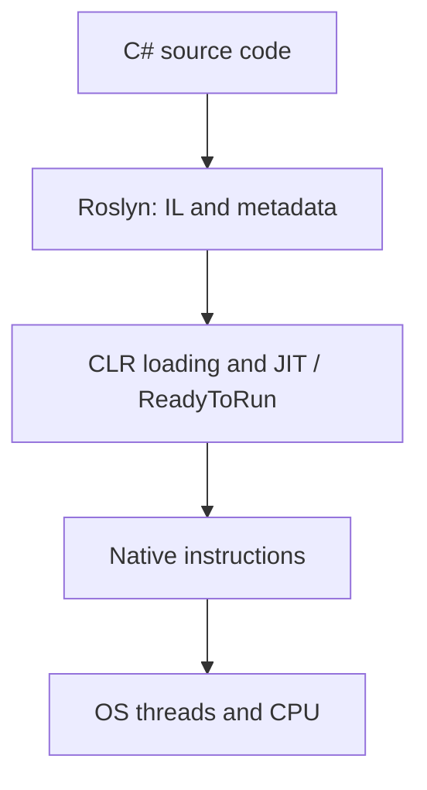

# C# / .NET

[Главная / Home](../../README.md) · [Все вопросы / Questions](../../questions/dotnet/README.md) · [Тема / Topic](async-await.md) · [Запуск / Run](../../docs/execution.md)

## Deep dives / Глубокая теория

- [async/await, Task, ValueTask, continuations](async-await.md)
- [ThreadPool, OS Scheduler and CPU](../../runtimes/clr/threadpool.md)
- [Memory model, lock, volatile, Interlocked](../../computer-science/concurrency/memory-model.md)
- [Roslyn, IL, JIT and runtime mechanisms](../../docs/internals-reference.md)
- [35 RU/EN questions](../../questions/dotnet/README.md)

## Слои исполнения

Путь исполнения зависит от режима публикации; Native AOT исключает обычную JIT-компиляцию в момент вызова.

[Главная / Home](../../README.md) · [Все вопросы / Questions](../../questions/dotnet/README.md) · [Тема / Topic](async-await.md) · [Запуск / Run](../../docs/execution.md)
