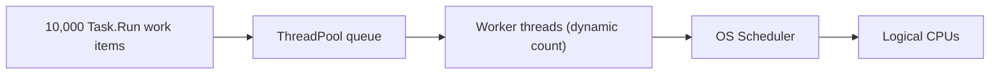

# ThreadPool, OS Scheduler and CPU

[Главная / Home](../../README.md) · [Все вопросы / Questions](../../questions/dotnet/README.md) · [Тема / Topic](README.md) · [Запуск / Run](../../docs/execution.md)

## Definitions / Определения

- **ThreadPool:** .NET runtime mechanism managing work queues and a dynamically sized set of reusable OS worker threads.
- **OS Scheduler:** the kernel subsystem assigning runnable OS threads to logical processors and handling preemption/migration.
- **TaskScheduler.Default:** schedules Task work using the ThreadPool; it does not select a CPU core.
- **Thread:** OS-schedulable sequence of instructions with its own execution context and stack.
- **Task:** a managed operation-completion abstraction, not necessarily one CPU worker or thread.

## How 8 CPU cores run work from 100 runnable threads

An OS scheduler chooses which 8 (assuming 8 logical CPUs) execute at a given instant. It may **preempt** a running thread and execute another without waiting for the original to finish. Runnable threads progress over time; hardware parallelism is bounded by logical CPUs. With SMT the number of logical CPUs can exceed physical cores.

## Resource accounting / Ресурсы

| Mechanism | Managed side | OS/kernel side | CPU implications |
|---|---|---|---|
| Task allocation | Task and captured references (path-dependent) | No per-Task OS thread | Scheduling/completion work |
| ThreadPool worker | Queues and worker structures | Native thread, virtual stack reservation, scheduler bookkeeping | CPU while running, not while blocked |
| Context switch | None required at Task level | Save/restore thread execution state | Scheduler cost and possible cache locality loss |
| `Task.Delay` timer | Task, timer registration | Runtime/OS timer machinery | CPU when timers fire and continuations run |
| Blocking `Thread.Sleep` | Blocked delegate/task | Worker occupies an OS thread | No useful CPU while asleep, but worker unavailable |

**No made-up numbers:** stack reservation, resident memory, worker count and context switching rate depend on OS/runtime settings and workload.

## Runtime diagnostics

.NET 10 diagnostics to inspect: `dotnet.thread_pool.thread.count`, `dotnet.thread_pool.queue.length`, `dotnet.timer.count`, `dotnet.process.cpu.time` and `dotnet.monitor.lock_contentions`. They measure different phenomena; thread count is not busy-thread count.

## Failure modes

- **Starvation:** runnable work is delayed because all workers are blocked or unavailable.
- **Deadlock:** cyclic waiting prevents progress, including with asynchronous waits.
- **Lock contention:** multiple workers compete for the same synchronization primitive.
- **Race:** unexpected scheduling changes correctness of shared state.

Try [Q-009](../../questions/dotnet/Q-009-task-delay-vs-thread-sleep.md) and [Q-011](../../questions/dotnet/Q-011-threadpool-worker-creation.md) before progressing to the memory model.

References: [Microsoft managed ThreadPool](https://learn.microsoft.com/en-us/dotnet/standard/threading/the-managed-thread-pool); [Debug ThreadPool starvation](https://learn.microsoft.com/en-us/dotnet/core/diagnostics/debug-threadpool-starvation).

[Главная / Home](../../README.md) · [Все вопросы / Questions](../../questions/dotnet/README.md) · [Тема / Topic](README.md) · [Запуск / Run](../../docs/execution.md)
